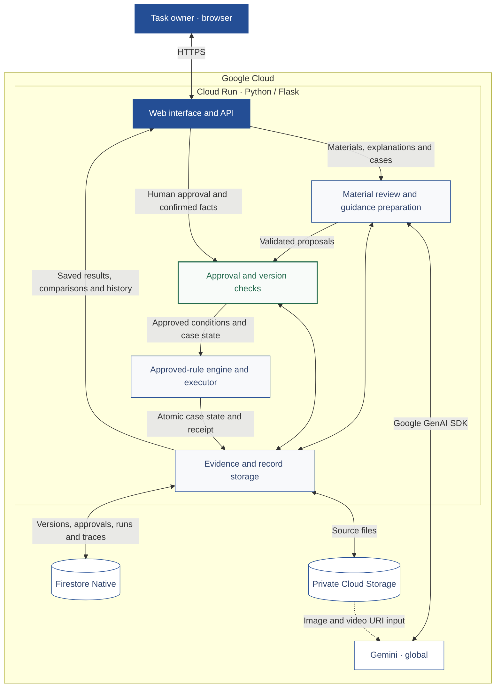

# Judgment Transfer — by SOLIFAN

**Use the task owner’s materials and explanations. Check which parts of the work AI can handle.**

Judgment Transfer identifies missing information and decisions that need a person. Test the instructions, add the task owner’s explanation, and compare what changes. The findings also help improve the handover to the next task owner.

[Open the application](https://judgment-transfer-unql76xapq-an.a.run.app/) · [Explore the recorded example](https://judgment-transfer-unql76xapq-an.a.run.app/assets/demo/index.html) · [User guide](START_HERE.md) · [日本語ガイド](START_HERE_ja.md)

## How it works

1. **Organize the work.** Describe the job and provide its materials and explanations. Gemini reviews the purpose, information, steps, decision conditions, exceptions and completion criteria, with references to the supplied evidence.
2. **Try the instructions.** Review and approve the proposed workflow. Add example cases, confirm their facts and starting states, and run a practice test.
3. **Explain what is missing.** Answer the targeted question and approve the proposed guidance.
4. **Compare the change.** Try the same cases from the same starting states. See what can proceed, what remains on hold, and what the next task owner needs to know.

**Gemini prepares proposals; people confirm the facts and approve the conditions. The application’s shared rule engine then applies the approved version to each case.** Saved results retain the responsible person, timestamp, source versions and judgment.

## Screenshots

Three screens from the recorded **v1.0.39** expense example. Select an image to open that step of the demo.

### 1. Find the missing rule

A question linked to the original instructions exposes the missing receipt-acceptance condition.

### 2. Verify the change

Sam’s claim moves from hold to precheck complete after the approved clarification.

### 3. Check new cases

Two additional cases show completion and a correction request, alongside a checklist for the next task owner.

[Capture details](docs/screenshots/README.md)

## A concrete example: expense document checks

The recorded example uses six fictional Cedarline Services hotel claims in USD. The original procedure covers company-addressed receipts but does not define when a receipt addressed to the employee can be accepted. Sam’s $348 claim is held because that condition is missing.

The task owner approves these acceptance conditions:

- The receipt addressee and named guest both match the claimant.
- Both stay dates match the approved dates.
- The employee-paid amount is explicitly stated, and that payment is marked **PAID**.

Once the receipt is accepted, the existing amount check compares the claim with the employee-paid amount. Missing payment information remains unknown; a changed stay still needs a manager’s decision.

| Case | Original instructions | With approved guidance | What the result shows |
|---|---|---|---|
| Alex Morgan | Precheck complete | Precheck complete | The company-addressed receipt remains acceptable. |
| Sam Rivera | Hold | Precheck complete | The receipt meets the approved criteria, and the $348 claim matches his payment. |
| Jordan Chen | Hold | Hold | The employee-paid amount and payment status are still missing. |
| Taylor Brooks | Hold | Hold | The stay ends one day after approval; a manager must decide the exception. |

Two additional cases were excluded from preparing the question and guidance:

- **Casey Lee:** the $276 claim matches the stated payment marked PAID, and the other required checks pass. The precheck completes.
- **Jamie Patel:** the $424 claim exceeds the stated employee payment of $264 by **$160**. The claim is returned for correction.

**Precheck complete means the documents are ready for a person’s business approval.** The practice test changes isolated case state; it does not approve or pay an expense.

### How the comparison was made

For this recorded example, the initial workflow and case facts were prepared and reviewed by the author from the supplied procedure and PDFs. Gemini generated the question and guidance proposal, which the task owner reviewed and approved. The same rule engine and code then applied the original and revised conditions to the same cases, facts and starting states.

The record contains **4 before + 4 after + 2 additional case executions**, with **zero model calls during case execution**. The demo displays these saved results. Its handover checklist brings together the approved criteria, payment checks, evidence requests and manager-decision boundaries.

These six cases demonstrate the effect of the approved explanation. They do not establish general accuracy, reliability across all workflows or measured handover-time savings.

[Comparison record](https://judgment-transfer-unql76xapq-an.a.run.app/api/v1/demo/expense) · [Case design and method](verification/RECEIPT139_DESIGN.md) · [Recorded evidence](verification/RELEASE139_STATUS.md)

## Architecture

The diagram shows the current approved-workflow path on Google Cloud.

### Technology stack

| Component | Role |
|---|---|
| Gemini through the Google GenAI SDK | Material review, questions and workflow or guidance proposals |
| Cloud Run · Python 3.12 / Flask / vanilla JavaScript | Application, browser interface and shared approved-rule engine |
| Firestore Native | Versioned workflows, approvals, runs and history; atomic case-state and receipt updates |
| Private Cloud Storage | Source files and evidence tied to the recorded versions |

[Architecture details and implementation map](docs/architecture.md)

## Try your own work

Open the application and enter **Job and intended result**. Add a file or the task owner’s explanation, then select **Organize the work**. Select **Prepare a practice test** when you are ready to review the proposed conditions and add cases.

Materials can include TXT, text PDF, PNG/JPEG and short MP4. Review extracted case facts before confirming them. The guides cover file limits, approval, saved work and result history.

[Operation and setup](START_HERE.md) · [日本語の操作ガイド](START_HERE_ja.md)

## Run and inspect

The guides include a local simulation and numbered Google Cloud Shell deployment steps. Dependencies are pinned in `requirements.lock`; the configured model is `gemini-3.5-flash` in `global`.

| Path | Contents |
|---|---|
| `app/web/` | Application, recorded demo and evidence viewer |
| `app/service.py`, `app/core/`, `app/approved_execution.py` | Workflow versions, approvals, conditions and execution |
| `app/adapters/`, `app/storage/` | Model integration, evidence validation and persistence |
| `steps/` | Numbered Cloud Shell runbook |
| `verification/`, `evaluation/` | Verification records and the original evaluation |

The [original evaluation report](evaluation/EVALUATION_REPORT.md) retains its separate protocol, measured outcomes and scope. [Change history](CHANGELOG.md) and [distribution notes](docs/distribution.md) identify the current application and repository editions.

## About SOLIFAN

Judgment Transfer is developed by **SOLIFAN**, drawing on practical business operations to make judgment criteria explicit and support reliable handovers.

[Visit SOLIFAN](https://www.solid-fdn.co.jp/)
