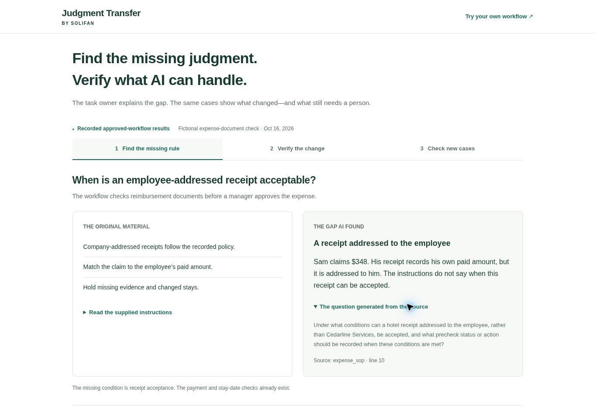
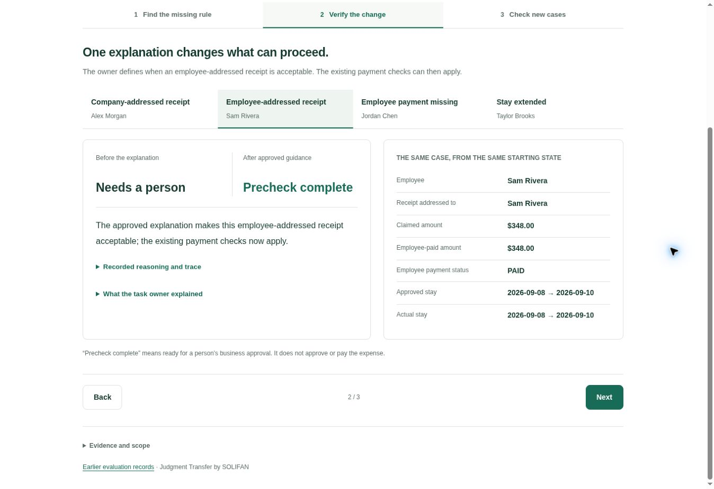
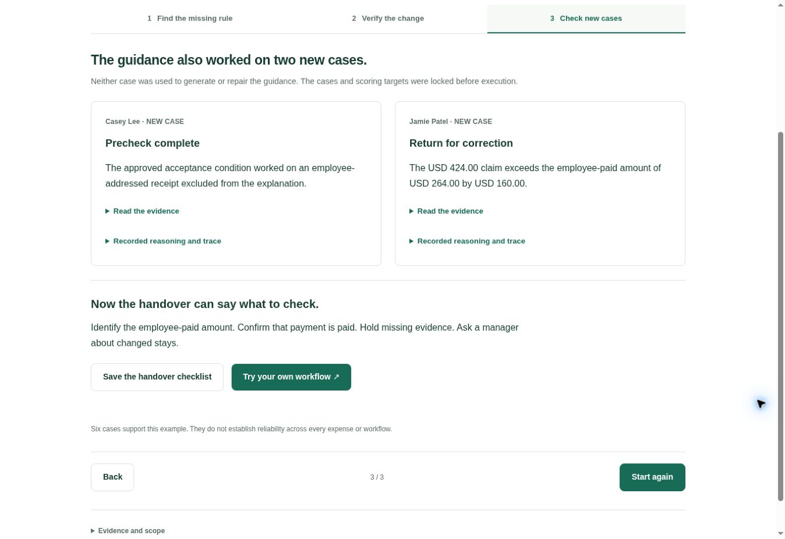
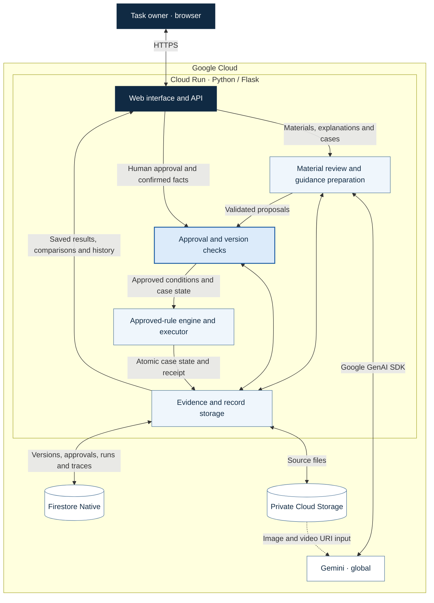

# Judgment Transfer — by SOLIFAN

**Use the task owner’s materials and explanations. Check which parts of the work AI can handle.**

Judgment Transfer identifies missing information and decisions that need a person. Test the instructions, add the task owner’s explanation, and compare what changes. The findings also help improve the handover to the next task owner.

[Open the application](https://judgment-transfer-unql76xapq-an.a.run.app/) · [Explore the recorded example](https://judgment-transfer-unql76xapq-an.a.run.app/assets/demo/index.html) · [Screenshots](#screenshots) · [Architecture](#architecture)

## From instructions to an evidence-backed result

1. **Organize the work.** Describe the job, upload its materials, and add an explanation or comment. AI reviews the purpose, required information, steps, decision conditions, exceptions and completion criteria, with references to the supplied evidence.
2. **Try the instructions.** Review and approve the proposed conditions. Add example cases, confirm their facts and starting states, and run them in an isolated workspace.
3. **Explain what is missing.** Read the targeted question, provide the task owner’s explanation, and approve the proposed guidance.
4. **Compare the change.** Try the same cases from the same starting states. See which can proceed, which need information, and which still require a person.

Finalized records retain the responsible person, timestamp, optional note, source versions and judgment. Open earlier records and compare them with later work. Deleting a record or resetting its history requires confirmation.

## Screenshots

Three screens from the **recorded v1.0.39 example**, using six fictional USD expense claims. Select an image to open that step of the demo.

### 1. Find the missing rule

The recorded demo identifies the missing acceptance condition for Sam’s employee-addressed receipt and shows the question linked to the original instructions.

### 2. Verify the change

Saved results show Sam’s $348 claim moving from hold to precheck complete after the approved clarification and existing amount check, with business approval still required.

### 3. Check new cases

Two cases excluded from guidance preparation show both completion and a correction request; the approved checks can also be saved as a handover checklist.

Captured on 17 October 2026. These screens display saved results; viewing the demo does not run cases or call Gemini. [Screenshot provenance](docs/screenshots/README.md).

## A concrete example: expense document checks

The current recorded example (**v1.0.39**, `PERSONAL_RECEIPT_139`) uses six fictional **Cedarline Services** hotel claims in **USD**. The original procedure covers company-addressed receipts, but does not define when a receipt addressed to the employee can be accepted. Sam Rivera’s $348 claim is held because that acceptance condition is missing.

**Shinji Okada approved these receipt-acceptance conditions in guidance version 1:**

- The receipt addressee and named guest both match the claimant.
- Both stay dates match the approved dates.
- The employee-paid amount is explicitly stated, and that payment is marked **PAID**.

Once the receipt is accepted, the **existing amount check** compares the claim with the stated employee-paid amount. A known mismatch is returned for correction. Missing payment details stay unknown: do not subtract a company prepayment from a total or infer who paid. A changed stay still needs a manager’s decision.

| Case | Original instructions | After approved guidance | What the result shows |
|---|---|---|---|
| Alex Morgan | Precheck complete | Precheck complete | The original company-receipt path remains valid. |
| Sam Rivera | Hold | Precheck complete | His employee-addressed receipt meets the approved criteria; the $348 claim matches his explicit PAID amount. |
| Jordan Chen | Hold | Hold | The employee-paid amount and payment status are still missing. |
| Taylor Brooks | Hold | Hold | The stay ends one day after approval; a manager must decide the exception. |

Two additional cases, excluded from preparing the question and guidance, were then checked:

- **Casey Lee:** the $276 claim matches the stated employee payment marked PAID and the other required checks pass; the precheck completes.
- **Jamie Patel:** the $424 claim exceeds the stated employee payment of $264 by **$160**; the claim is returned for correction.

**Precheck complete means the documents are ready for a person’s business approval.** These isolated review states do not approve expenditure, execute payment or send a message.

### How the comparison was made

Gemini prepared the question and guidance proposal; the task owner approved the conditions. The same approved-rule engine and code applied the original and revised conditions to the same four cases, facts and starting states. The record contains **4 before + 4 after + 2 additional case executions**, with **zero model calls during case execution** and **two model attempts during preparation**. Case facts are author-reviewed transcriptions of the supplied PDFs.

The six cases demonstrate how an approved explanation changes what can proceed while necessary holds remain. They do not establish general AI accuracy, reliability across all workflows or measured handover-time savings.

The [three-step demo](https://judgment-transfer-unql76xapq-an.a.run.app/assets/demo/index.html) presents the saved results and supporting records. It also provides a downloadable handover checklist with the approved criteria, payment checks, evidence requests and manager-decision boundaries. Opening the recorded demo makes no model calls.

[Current comparison record](https://judgment-transfer-unql76xapq-an.a.run.app/api/v1/demo/expense) · [Scenario design and six cases](verification/RECEIPT139_DESIGN.md) · [Published-record status](verification/RELEASE139_STATUS.md)

## Try your own work

Open the application and enter **Job and intended result**. Use **Upload file** for a document or **Explanation or comment** for the task owner’s knowledge, then select **Organize the work**. Select **Prepare a practice test** when you are ready to review the conditions and add cases.

Supported materials are TXT, text PDF, PNG/JPEG and short MP4. The input accepts up to five files and 20 MiB in total; individual limits appear beside the upload control. Cases can be read from a file or entered through fields generated for the approved workflow. Review extracted facts before confirming them. Missing facts remain unknown.

Use **Responsible person** when approving or finalizing work. **Decision history** opens saved evidence and judgments; **Saved tests** opens execution results. All test actions affect isolated case state.

## Architecture

**Current cloud application · v1.0.39.** The diagram follows the approved-workflow path used by the application and the current recorded example.

- **Prepare, then approve.** Gemini reviews materials and proposes workflow conditions, questions and guidance. The application validates source references; the task owner reviews and approves the conditions and confirms case facts before execution.
- **Execute approved conditions.** The shared engine evaluates confirmed facts and frozen starting states against the approved version. Unknown or conflicting required conditions keep a case on hold. Case state and its execution receipt are committed together in Firestore; traces are saved separately.
- **Inspect saved evidence.** The API retrieves saved results for comparison, history and export. The recorded demo reads a separately published snapshot through a read-only endpoint. Viewing these records does not run cases or call Gemini.
- **Keep the source connection visible.** TXT and text PDF content is supplied as extracted text. Images and short videos are supplied through private Cloud Storage URIs. The dotted arrow denotes media input to Gemini; the application controls source-file and record writes.

The original A/B model-evaluation paths are retained separately in the repository. The diagram shows the current `C_JT_RULES` path, whose case execution uses `APPROVED_RULE_ENGINE_V1` without model calls.

**Inspect the implementation:** [Web/API](app/main.py) · [Preparation and approvals](app/service.py) · [Approved-rule engine](app/approved_execution.py) · [Model and evidence input](app/adapters/model.py) · [Persistence](app/storage/repository.py) · [Comparison](app/comparison.py)

## Why Google Cloud

| Component | Role in Judgment Transfer |
|---|---|
| Gemini through the Google GenAI SDK | Reads multimodal materials, identifies missing information and questions, and proposes workflow conditions and guidance |
| Cloud Run | Hosts the Python/Flask application and its English browser interface |
| Approved-rule engine in the application | Applies approved conditions to confirmed cases and records outcomes and required next actions |
| Firestore Native | Stores versioned workflows, approvals, runs and history; commits case state and execution receipts atomically |
| Private Cloud Storage | Retains source files and evidence tied to the recorded versions |

AI proposes and interprets. After the task owner approves the conditions, the application’s shared rule engine applies them to confirmed cases. Application checks validate source references, require approval before guidance becomes active, and control which declared state changes can execute. Unknown or conflicting required conditions keep a case on hold. Workflow fields, actions and conditions are declarations shared by the same core across business domains.

## Run and inspect

See [Setup and operation](START_HERE.md) for local simulation and Google Cloud Shell deployment. The runtime is Python 3.12, Flask and vanilla JavaScript; dependencies are pinned in `requirements.lock`. The configured Google model is `gemini-3.5-flash` in `global`.

| Path | Contents |
|---|---|
| `app/web/` | Application, recorded demo and evidence viewer |
| `app/service.py`, `app/core/` | Workflow versions, approvals, conditions, execution and receipts |
| `app/adapters/`, `app/storage/` | Model integration, evidence validation and persistence |
| `steps/`, `releases/` | Numbered Cloud Shell runbook and versioned updates |
| `verification/`, `evaluation/` | Focused checks, recorded results and the original evaluation |

The [original evaluation report](evaluation/EVALUATION_REPORT.md) retains its separate protocol, measured outcomes and failed calls. [Change history](CHANGELOG.md) records subsequent fixes. These records can be inspected without rerunning the evaluation.
